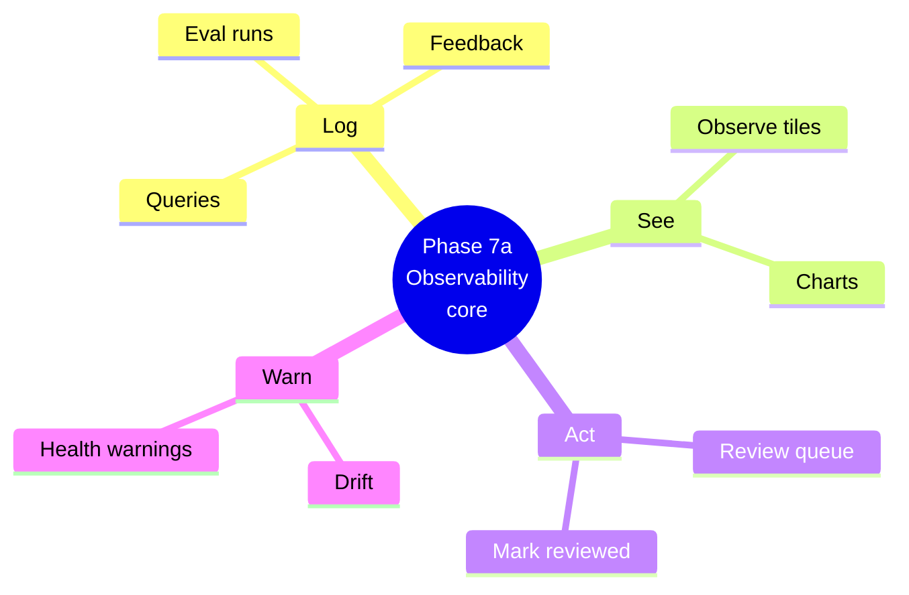
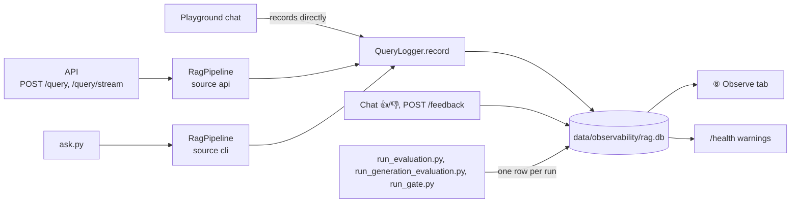
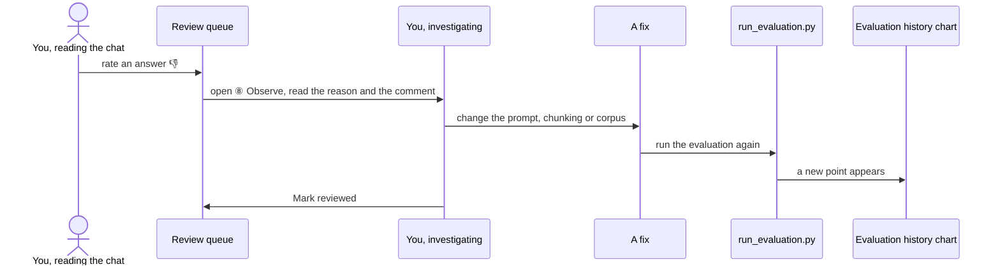

# Phase 7a — Observability core, explained simply

Until now, every answer disappeared the moment it left the model: the console got one JSON log line, then it was gone. Rate an answer 👎 in the chat, and that rating vanished on the next reload. Phase 7a gives the system a memory: every answered question, every rating and every evaluation run is written to one local file, so you can see how the system behaves **over time**, not just what it did a moment ago.

> **Analogy.** A car's dashboard shows the speed right now; the service log tells you the brakes are wearing faster than last month. **⑧ Observe** is both: the tiles and charts are the dashboard, the drift warnings and review queue are the service log flagging something worth a look.



Part A explains the ideas. Part B walks through the code and shows you how to try it.

---

## Part A — The ideas

### 1. Where the data comes from

Three different doors answer questions — the API, `ask.py`, and the playground chat — and all three funnel into the same log.



`RagPipeline` records on every answer and on every failure. The golden-set evaluation itself never writes a `queries` row — asking the same 30 questions over and over would drown out real traffic — but each evaluation script adds exactly one `eval_runs` row when it finishes.

The diagram simplifies one thing: when the API runs in Docker, its rows land in its own `rag-api.db`, not the host's `rag.db` (see "One writer per file" under Part B) — the ⑧ tab still shows both, merged.

### 2. What is stored

Everything on the host lands in one SQLite file, `RAG_OBSERVE_DB` (default `data/observability/rag.db`), in four tables. The Docker API writes the same four tables to its own file instead (`rag-api.db` — see "one writer per file" below), which the tab reads back read-only and merges in.

| Table | One row per | Notable columns |
|---|---|---|
| `queries` | an answered question, or a failed one | `source` (`api` / `playground` / `cli`), the question and answer text, model, prompt version, tokens, timings, cost, refusal, invalid citations |
| `feedback` | a rating | which `query_id`, up (`1`) or down (`0`), an optional comment. Re-rating an answer adds a new row; the **newest** one is what is shown, older ones are kept |
| `eval_runs` | one run of `run_evaluation.py`, `run_generation_evaluation.py` or `run_gate.py` | `kind` (`retrieval` / `generation` / `gate`), pass or fail, the scored metrics, a fingerprint hash |
| `reviews` | a query marked reviewed | `query_id`, `ts` — kept separate from `queries` so the host can mark a query answered only in a read-only log (e.g. the API's) as reviewed |

Question and answer text are stored in full by default, because this is a learning project you run against your own data. If that ever matters, set `RAG_OBSERVE_STORE_TEXT=false`: the question is kept only as a `sha256:<hex>` hash and the answer is dropped entirely, so the rest of the log — timings, tokens, citations, ratings — still works for spotting drift, just without the words. Either way, `data/observability/` is git-ignored: it can hold real question text, so it must never reach the repo.

### 3. Drift, explained

A system can get quietly worse — a model update, a corpus change, a prompt tweak — long before anyone notices. Drift checks catch that by comparing **recent** traffic with the traffic **just before it**.

Local traffic is light and bursty, so a calendar window ("today vs. yesterday") could compare 2 questions against 200. Counting answers instead keeps both sides the same size: the last `RAG_DRIFT_WINDOW` answers (default 20) against the `RAG_DRIFT_WINDOW` before them, across every source together. With fewer than `2 × window` answers logged, the tab just says there isn't enough data yet.

| Check | Warns when | Setting (default) |
|---|---|---|
| p95 total latency | recent p95 > previous p95 × (1 + rise) | `RAG_DRIFT_LATENCY_RISE` = 0.5 |
| Error rate | recent − previous ≥ rise | `RAG_DRIFT_ERROR_RISE` = 0.10 |
| Refusal rate | recent − previous ≥ rise | `RAG_DRIFT_REFUSAL_RISE` = 0.15 |
| Invalid-citation rate | recent − previous ≥ rise | `RAG_DRIFT_CITATION_RISE` = 0.10 |
| 👎 rate | recent − previous ≥ rise, and at least 5 ratings in each window | `RAG_DRIFT_DOWNVOTE_RISE` = 0.20 |
| Evaluation | the latest run of a kind failed, or a retrieval metric fell more than `RAG_GATE_MAX_DROP` since the previous run of that kind | the existing gate settings |

Each warning names both numbers, for example:

> Refusal rate rose from 5% to 25% (last 20 vs previous 20 answers).

Drift is never stored — it is computed fresh from `queries`, `feedback` and `eval_runs` every time ⑧ Observe or `/health` is asked for it, so there is nothing to keep in sync.

### 4. The review loop

Drift tells you *something* changed; the review queue tells you *which answer* to look at.



An answer joins the queue for one of five reasons: 👎, an error, a refusal, an invalid citation, or being slower than `RAG_REVIEW_SLOW_MS` (default 30 s). 👎 answers show first, then errors, then everything else, newest first. **Mark reviewed** just hides it from the default view — a **Show reviewed** toggle brings it back.

### 5. Cost

Cost is just tokens times price: `cost_usd = input_tokens × RAG_PRICE_INPUT_PER_1M / 1,000,000 + output_tokens × RAG_PRICE_OUTPUT_PER_1M / 1,000,000`. Both prices default to `0`, because the default generator is `qwen3:8b` on Ollama, running on your own machine — genuinely free. The summary tiles show `local · $0` whenever both prices are zero, and a real dollar figure once you set them.

If you switch `RAG_LLM_PROVIDER` to a hosted model, set the two prices from that provider's current pricing page, e.g.:

```bash
RAG_PRICE_INPUT_PER_1M=0.15
RAG_PRICE_OUTPUT_PER_1M=0.60
```

(Those two numbers are only an example of the shape — check the real, current price before trusting the total.)

---

## Part B — The code

| File | What it does |
|---|---|
| `observability/store.py` | `ObserveStore`: opens the SQLite file, creates or migrates the schema (tracked in `PRAGMA user_version`, now v2 for the `reviews` table), and inserts/reads `QueryRecord`, `FeedbackRecord` and `EvalRunRecord` rows. One short connection per call, `journal_mode=DELETE` and a 5 s busy timeout. **One writer per file**, not best effort: a stress test showed the API container and the host writing the *same* file through a Docker Desktop bind mount corrupts it within a fraction of a second, because that bind mount does not carry SQLite's POSIX locks between the Mac and the container's Linux VM. So the Docker API writes only its own `rag-api.db`; everything on the host writes `rag.db`. `ObserveStore(path, read_only=True)` opens another process's file through a read-only, immutable SQLite URI instead — it never locks and never writes, so it can never corrupt the writer's file. If a log is ever reported corrupt, move it aside to start fresh. |
| `observability/logset.py` | `LogSet(host, readonly=())`: the ⑧ tab's single read API over the host's `rag.db` plus any read-only logs (`RAG_OBSERVE_READONLY_DBS`, default `rag-api.db`). Merges and sorts every store's rows, fills in `reviewed_at` from the host's `reviews` table, skips a broken read-only store with a warning (the host's own errors still propagate), and always writes `mark_reviewed` to the host. |
| `observability/logger.py` | `QueryLogger.record` / `record_error` turn an `Answer` (or a failure) into one `queries` row; both **never raise** — a failed write just logs a warning and returns `None`. `create_query_logger(settings, source)` builds one from settings, or returns `None` when `RAG_OBSERVE_ENABLED=false`. `create_logset(settings)` builds the `LogSet` above. `record_feedback` and `record_eval_run` add the other tables' rows. |
| `observability/cost.py` | `cost_usd(input_tokens, output_tokens, prices)`: tokens × `RAG_PRICE_INPUT_PER_1M` / `RAG_PRICE_OUTPUT_PER_1M`. |
| `observability/review.py` | `review_queue`: which answers deserve a look, and why — 👎, error, refused, invalid citation, or slow. 👎 first, then errors, then the rest, newest first. |
| `observability/drift.py` | `drift_report`: the traffic and evaluation comparisons described above, as one list of plain-English warnings. |
| `observability/dashboard.py` | Pure data prep for the tab: summary tiles, time buckets for the charts, evaluation history per metric (falling back to the committed baselines as reference points), and the recent-queries table rows. |
| API: `query_id` | `POST /query`'s response and the `done` event of `/query/stream` now carry `query_id` — the row's id in `queries`, or `null` when observability is off or the write failed. |
| API: `POST /feedback` | `201 {"id": "..."}` on success, `404` for an unknown `query_id`, `503` when observability is off. Guarded like `/query` (rate limit, then API key). |
| API: `/health` warnings | `HealthResponse.warnings` carries the same drift warnings ⑧ Observe shows. A failure while computing them never changes the `200`/`503` status — drift is information, never an outage. |
| `playground/tabs/observe.py` | The ⑧ Observe tab: drift banner, time-range selector, 8 summary tiles, latency/volume/tokens charts, evaluation history with baseline and threshold lines, the review queue with **Mark reviewed**, and a recent-queries table with a detail view. |

```bash
curl -s -X POST http://127.0.0.1:8000/feedback \
  -H 'Content-Type: application/json' \
  -d '{"query_id": "3f9a1c...", "rating": "down", "comment": "Cited the wrong page"}'
```

```json
{"id": "b7c15e..."}
```

---

## Try it

1. Open the playground chat and ask three different questions.
2. Rate one answer 👎 (the thumbs-down icon under the reply).
3. Open **⑧ Observe**: the tile row, the latency/volume/tokens charts and the recent-queries table now include your three questions; the review queue shows the one you rated down.
4. Click **Mark reviewed** on that item — it drops off the queue (turn on **Show reviewed** to see it again).
5. Run `uv run python scripts/run_evaluation.py`, then reload ⑧ Observe: a new point appears on the evaluation history chart for Recall@k, MRR and NDCG@k.
6. With the API running (`uv run python scripts/serve_api.py`), copy a `query_id` from a `/query` response and send it feedback with the curl command above; reload ⑧ Observe and it shows up in the recent-queries detail view.

What to notice: it is the same three tables behind the chat, the API and every evaluation script — nothing here is a separate system to keep in sync.
