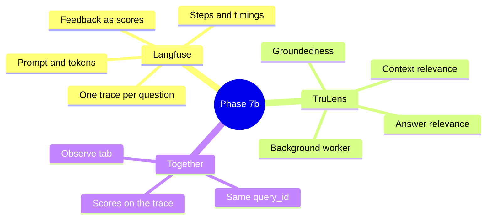
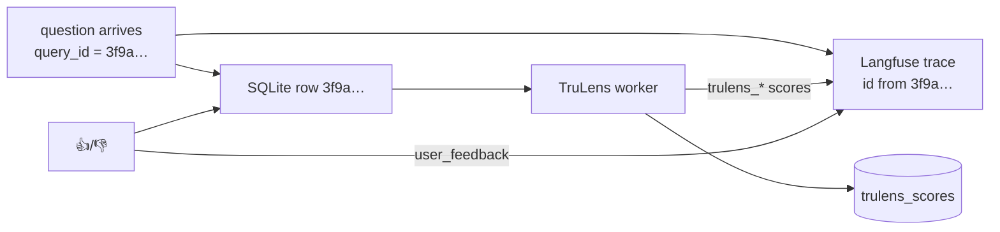

# Phase 7b — Tracing and automatic scoring, explained simply

Phase 7a gave the system a memory: every answer is a row in SQLite. But a row only says *what* came out. It doesn't show *how* the answer was made, and nobody checks whether it was any good unless a user clicks 👎. Phase 7b adds the two tools teams use for that, each for what it does best:

- **Langfuse** records a **trace** of every question: each step it went through, in order, with its inputs, outputs and timings. You read it in Langfuse's web app.
- **TruLens** gives every answer three **scores** (the "RAG triad"), from a small local judge model, in the background.

> **Analogy.** A trace is a parcel's tracking history: picked up 09:02, sorted 09:40, out for delivery 11:15. When a parcel is late, the history shows *where* it got stuck. The triad is the customer survey after delivery: did the right parcel arrive, undamaged, and was it what was ordered? One tells you what happened; the other tells you whether it was good.



The SQLite log from 7a stays the single source of truth. Both tools are add-ons: each can be switched off, and a failure in either never breaks or slows an answer.

Part A explains the ideas. Part B walks through the code. Then try it.

---

## Part A — The ideas

### 1. One question, one trace

Every question (from the playground, `ask.py` or the API) becomes one trace in your Langfuse project:

```
answer-question      the whole question: input = question, output = answer
├─ retrieve-context  which chunks came back, with their scores
├─ rerank-chunks     the order before and after (only when re-ranking is on)
└─ generate-answer   the model, the full prompt, tokens, time to first token
```

The names are **verbs** and never change between runs, so you can filter and build dashboards on them in Langfuse. Anything that changes per run (top-k, the collection, the answer style) goes into the trace's metadata and tags instead.

`generate-answer` is recorded by Langfuse's own OpenAI integration (`langfuse.openai`), not by our code. It already knows how to read the model, the prompt, token counts and streaming.

### 2. One id ties everything together

When a question arrives, the system picks its `query_id`. That one id is:

- the row's id in SQLite,
- the seed of the trace's id in Langfuse (`create_trace_id(seed=query_id)`),
- what a 👍/👎 or a TruLens score is sent with.

So a score that arrives a minute later (TruLens) or a day later (a user's 👎) lands on the right trace, and nothing else needs storing.



### 3. The RAG triad

A RAG answer can go wrong in three different places, so TruLens asks three different questions:

| Score | Question it answers | When it is low |
|---|---|---|
| **Context relevance** | Did retrieval find text that is about the question? (average over the retrieved chunks) | Retrieval is the problem: chunking, embeddings, top-k |
| **Groundedness** | Is every claim in the answer supported by that text? | The model is making things up (hallucinating) |
| **Answer relevance** | Does the answer actually address the question? | The model answered something else, or rambled |

> **Analogy.** A student writes an essay from library books. Context relevance: did they fetch the right books? Groundedness: does every sentence come from those books? Answer relevance: does the essay answer the essay question?

Each score is 0 to 1, and comes with the judge's reasons. For groundedness, the reasons list **each claim** in the answer with the evidence found for it (or "NOTHING FOUND"), which makes a hallucination easy to spot.

### 4. Why a small judge, in the background

Phase 4 judges with `gemma3:12b`: careful, but about two minutes per answer and 8 GB of memory. Fine for 30 golden questions once in a while, too heavy for every answer. TruLens uses **`gemma3:4b`**, about 3.3 GB, which stays loaded next to `qwen3:8b`, so models are not swapped in and out.

It runs **after** the answer is delivered, on one background thread with a queue (`ScoreWorker`). In our test, an answer came back in 12 seconds and its scores were saved about 45 seconds later. The person asking never waits for them.

A small judge is noisier than a big one. Read the trend, and the reasons on low scores, rather than trusting any single number. The careful, gated numbers still come from Phase 4 and the CI gate.

### 5. What if a score is missed?

Some answers are never scored in the background:

- `ask.py` exits right after answering, so a background thread would be cut off.
- The queue is full (more than `RAG_TRULENS_QUEUE_SIZE` waiting).
- The judge was down, or the process stopped mid-way.

None of these lose anything: the answer is in SQLite without scores. `scripts/run_trulens.py --pending` scores every such answer later.

### 6. Privacy

With Langfuse Cloud, the question, the answer, the retrieved text (including documents you upload in the playground) and the prompt are sent to Langfuse. The chat shows a one-line note while that is on. With `RAG_OBSERVE_STORE_TEXT=false`:

- placeholders are sent instead of any text,
- 👍/👎 comments stay local,
- TruLens skips those answers, because there is no text to judge.

A failed step only ever sends the error's **type** (for example `GenerationError`), never its message, which can name internal hosts. TruLens sends nothing anywhere: it runs locally against Ollama.

---

## Part B — The code

| File | What it does |
|---|---|
| `observability/tracing.py` | The vendor-neutral `Tracer` protocol (`start`, `score`, `trace_url`, `flush`) and `NOOP_TRACER`, the default. Pipeline, API and playground depend only on this. |
| `observability/langfuse_tracer.py` | `LangfuseTracer`: the Langfuse version. `create_tracer(settings)` returns it only when tracing is on, both keys are set and the `monitoring` extra is installed; otherwise `NOOP_TRACER`. Every SDK call is wrapped and never raises. |
| `observability/trulens_scorer.py` | `TriadScorer.score(question, contexts, answer)`: calls TruLens' three feedback functions through its LiteLLM provider (`ollama/gemma3:4b`), clamps values to 0–1, keeps the reasons, and raises `TriadScoreError` when the judge's reply can't be read (so nothing half-scored is saved). |
| `observability/score_worker.py` | `ScoreWorker`: the background thread and bounded queue. For each `query_id`: load the row, skip refusals, errors and hidden text, fetch the chunk text from Chroma (`ChromaVectorStore.texts`), score, save, send to Langfuse. `get_score_worker(settings)` gives one per process. |
| `observability/logger.py` | `QueryLogger(on_recorded=...)`: after an answer is saved, hands its `query_id` to the worker. `create_query_logger` wires this for the API and playground, not for `ask.py`. |
| `observability/store.py` | Schema v3: the `trulens_scores` table (`query_id`, `metric`, `value`, `reason`, `judge`, `ts`), with `save_triad_scores`, `triad_scores_for` and `unscored_query_ids`. A v2 file upgrades in place. |
| `observability/trulens_cli.py` + `scripts/run_trulens.py` | The catch-up command. Exit 0 = done, 1 = some answers still failed (they stay pending), 2 = cannot run. |
| `observability/status.py` | Whether each tool is on, off on purpose, or broken (and how to fix it), for the header pills. |
| `api/main.py` | On shutdown: finish queued scores first, then flush Langfuse, so the last scores aren't lost. |
| `playground/tabs/observe.py` | ⑧ Observe: the **Answer quality (TruLens)** tiles and trend chart, three score columns in the recent-queries table, and, for a selected answer, each score with its reasons and **Open trace in Langfuse**. |

Settings (all have defaults; see `.env.example`):

| Setting | Default | What it does |
|---|---|---|
| `LANGFUSE_PUBLIC_KEY`, `LANGFUSE_SECRET_KEY` | empty | Your Langfuse project's keys. Only in `.env`; tracing is off without them. |
| `LANGFUSE_BASE_URL` | `https://cloud.langfuse.com` | EU region; `https://us.cloud.langfuse.com` for US. |
| `RAG_LANGFUSE_ENABLED` | `true` | Tracing on or off. |
| `RAG_TRULENS_ENABLED` | `true` | Background scoring on or off. The catch-up command runs either way. |
| `RAG_TRULENS_JUDGE_MODEL` | `gemma3:4b` | Must differ from `RAG_LLM_MODEL`. |
| `RAG_TRULENS_QUEUE_SIZE` | `100` | Answers waiting beyond this are left for the catch-up command. |

---

## Try it

```bash
uv sync --all-extras --all-groups     # includes the monitoring extra (langfuse, trulens)
ollama pull gemma3:4b                 # the TruLens judge
uv run streamlit run src/rag_eval_platform/playground/app.py
```

1. Check the header: **Langfuse on** and **TruLens · gemma3:4b** should be green. Hover a pill to see what it means; a red one says how to fix it.
2. Ask a question in the chat and wait for the answer.
3. Open **⑧ Observe** and wait about a minute, then rerun the page: under **Answer quality (TruLens)**, the tiles show the three scores and the table has them in its last three columns.
4. Click that row. Expand **Why** under Groundedness: each claim in the answer, with the evidence the judge found.
5. Click **Open trace in Langfuse**. You'll see the `answer-question` trace with its steps, and under **Scores**: `trulens_context_relevance`, `trulens_groundedness` and `trulens_answer_relevance`.
6. Rate the answer 👎 in the chat: `user_feedback = false` appears on the same trace.
7. Ask something with `uv run python scripts/ask.py "What is groundedness?"`. It isn't scored in the background, so run `uv run python scripts/run_trulens.py --pending --last 1` and reload ⑧ Observe.

What to notice: a low **context relevance** with high **groundedness** means the model faithfully used poor retrieval, so fix retrieval, not the prompt. High context relevance with low groundedness is the opposite: retrieval was fine and the model drifted from it.
