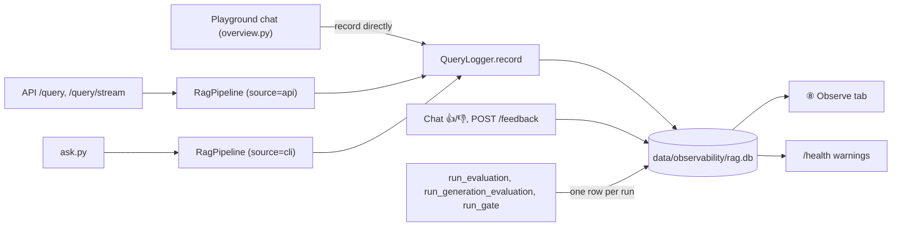

# Phase 7a — Observability core (SQLite): design

**Status:** approved in conversation, awaiting written-spec review
**Branch:** `feat/phase-7-observability`
**Follows:** Phase 6 (API and deployment). **Followed by:** Phase 7b (TruLens and Langfuse integrations, separate spec).

## Goal

Every answered question, every piece of feedback and every evaluation run is stored in one local SQLite file, and a new playground tab, **⑧ Observe**, shows traffic, latency, cost, quality over time, drift warnings and a review queue. Today each answer is only a JSON log line on the console, and 👍/👎 ratings are lost on reload.

## Decisions already made

| Decision | Choice |
|---|---|
| Scope of 7a | Query log + ⑧ Observe tab, feedback + review queue, evaluation history, drift alerts |
| Storage | SQLite through the standard library `sqlite3` (no new dependency) |
| Question text | Stored in full by default; `RAG_OBSERVE_STORE_TEXT=false` stores a SHA-256 hash instead of question and answer text |
| TruLens, Langfuse | Mandatory, but in Phase 7b with their own spec. The TruLens dashboard package is excluded: it pins `plotly<7`, the playground needs `plotly>=7.1`; TruLens scores will be shown in ⑧ Observe |
| Alerts storage | None: drift is computed when read |

## Architecture

### Modules (`src/rag_eval_platform/observability/`)

| Module | Responsibility |
|---|---|
| `store.py` | `ObserveStore(path, read_only=False)`: opens the SQLite file, creates or migrates the schema (tracked with `PRAGMA user_version`, now v2 for the `reviews` table), inserts and reads rows. `journal_mode=DELETE`, `busy_timeout=5000`, one short connection per operation — safe for two writers *on the host* (Streamlit threads and a locally run API/CLI), but **not** across the Docker Desktop bind mount; see "Docker and repository" below for why `read_only` exists. Frozen dataclasses for rows: `QueryRecord`, `FeedbackRecord`, `EvalRunRecord`. |
| `logset.py` | `LogSet(host, readonly=())`: the ⑧ tab's single read API (`queries`, `recent_queries`, `count_queries`, `feedback_for`, `eval_runs`, `get_query`, `mark_reviewed`) merging the host's `ObserveStore` with any read-only ones. Merges and sorts by `(ts, id)`; applies the host's `reviews()` to fill in `reviewed_at`; a read-only store that raises is skipped for that read with one warning (the host's errors propagate); `mark_reviewed` always writes to the host. |
| `logger.py` | `QueryLogger(store, source, settings)` with `record(answer, *, retrieve_ms, total_ms, collection, style) -> str \| None` and `record_error(question, error, *, collection, style, total_ms) -> str \| None`. Returns the new query id, or `None` when disabled or when the write failed. **Never raises**: a failed write logs a warning. `create_query_logger(settings, source) -> QueryLogger \| None` and `create_logset(settings) -> LogSet \| None` both return `None` when `RAG_OBSERVE_ENABLED=false`; `create_logset` skips a read-only path that resolves to the same file as `RAG_OBSERVE_DB`. |
| `cost.py` | `cost_usd(input_tokens, output_tokens, prices) -> float` from `RAG_PRICE_INPUT_PER_1M` and `RAG_PRICE_OUTPUT_PER_1M` (default 0, Ollama). |
| `drift.py` | Pure: `drift_warnings(queries, feedback, eval_runs, thresholds) -> DriftReport` (warnings, or "not enough data" with counts). |
| `review.py` | Pure: `review_queue(queries, feedback, slow_ms, include_reviewed) -> list[ReviewItem]` with reason badges and ordering. |
| `dashboard.py` | Pure data preparation for the tab: summary tiles (p50/p95 latency, error, refusal and 👍 rates, tokens, cost), time series by source, evaluation history series with thresholds, and the baselines fallback. |

## Data model

`queries`

| Column | Type | Notes |
|---|---|---|
| `id` | TEXT PK | `uuid4().hex` |
| `ts` | TEXT | UTC ISO-8601 |
| `source` | TEXT | `api`, `playground` or `cli` |
| `collection` | TEXT | e.g. `rag_documents`, `playground` |
| `question` | TEXT | or `sha256:<hex>` when text storage is off |
| `answer` | TEXT NULL | NULL on error or when text storage is off |
| `style` | TEXT | `concise` or `detailed` |
| `prompt_version`, `model` | TEXT NULL | |
| `refusal` | INTEGER | 0/1 |
| `retrieved_chunk_ids`, `cited_doc_ids`, `invalid_citations` | TEXT | JSON arrays |
| `input_tokens`, `output_tokens` | INTEGER NULL | |
| `retrieve_ms`, `generate_ms`, `total_ms` | REAL NULL | |
| `cost_usd` | REAL | |
| `status` | TEXT | `ok` or `error` |
| `error` | TEXT NULL | exception class and message |
| `reviewed_at` | TEXT NULL | legacy column from schema v1; a v1 file's existing values are kept and used as a fallback when a query has no row in `reviews` |

`feedback`: `id` TEXT PK, `query_id` TEXT (FK → queries.id), `ts`, `rating` INTEGER (1 up, 0 down), `comment` TEXT NULL (≤ 500 chars), `source` TEXT. The latest row per query wins (re-rating replaces the displayed rating; history is kept).

`eval_runs`: `id` TEXT PK, `ts`, `kind` (`retrieval`, `generation`, `gate`), `passed` INTEGER, `metrics` TEXT (JSON object of metric → value), `fingerprint` TEXT NULL (hash of the `EvalFingerprint`).

`reviews` (schema v2, new in this revision): `query_id` TEXT PK, `ts` TEXT NOT NULL. Split out of `queries.reviewed_at` because `mark_reviewed` no longer requires the query to live in the same file — a query answered only by the Docker API (in its own read-only `rag-api.db`) can still be marked reviewed, from the host store. Reading a query joins `queries` with `reviews` (`COALESCE(reviews.ts, queries.reviewed_at)`), so `mark_reviewed` on an unknown `query_id` now always returns `True` instead of `False`. A v1 file upgrades in place (`CREATE TABLE IF NOT EXISTS reviews` runs when `user_version < 2`), keeping its existing rows and their `reviewed_at` values.

Indexes on `queries(ts)`, `queries(source, ts)`, `feedback(query_id)`, `eval_runs(kind, ts)`.

## Where recording happens

- `RagPipeline(retriever, generator, recorder=None)`: `ask_timed` records on success; on an exception it calls `record_error` and re-raises. `ask_stream` records in the existing `on_complete` callback; a stream that raises while being consumed records an error. `TimedAnswer` gains `query_id: str | None`. For streams, the id is exposed on the returned stream wrapper after completion (the API's `done` event includes it).
- `ask.py` builds its pipeline with `source="cli"`; the API with `source="api"` (collection = `settings.collection_name`).
- The playground calls `QueryLogger.record` itself after its stream finishes in `tabs/overview.py` (`source="playground"`, collection `playground`), and stores the id on the chat `Turn` (`query_id: str | None = None`).
- Golden-set evaluation does **not** write `queries`. `run_evaluation.py`, `run_generation_evaluation.py` and `run_gate.py` each write one `eval_runs` row (skipped when disabled; a failed write only warns).

## API changes

- `QueryResponse.query_id: str | None`; the stream's `done` event carries the same field.
- `POST /feedback` (guarded like `/query`): body `FeedbackRequest {query_id: str, rating: "up" | "down", comment: str | None (≤ 500, stripped)}`, `extra="forbid"`. Returns `201 {"id": "<feedback id>"}`; `404 {error, hint}` for an unknown query id; `503 {error, hint}` when observability is disabled or the store is unavailable.
- `HealthResponse.warnings: list[str]` (drift warnings). Warnings never change the 200/503 status. Computing them must never make `/health` fail: any error yields no warnings and a log line.

## Drift

Count-based windows: the last `RAG_DRIFT_WINDOW` (default 20) queries against the `RAG_DRIFT_WINDOW` before them, across all sources. With fewer than `2 × window` queries, the report is "not enough data yet (n of 2×window)" and no warnings.

| Check | Warns when | Setting (default) |
|---|---|---|
| p95 total latency | recent > previous × (1 + rise) | `RAG_DRIFT_LATENCY_RISE` = 0.5 |
| Error rate | recent − previous ≥ rise | `RAG_DRIFT_ERROR_RISE` = 0.10 |
| Refusal rate (ok queries) | recent − previous ≥ rise | `RAG_DRIFT_REFUSAL_RISE` = 0.15 |
| Invalid-citation rate (ok queries) | recent − previous ≥ rise | `RAG_DRIFT_CITATION_RISE` = 0.10 |
| 👎 rate (rated queries) | recent − previous ≥ rise, and ≥ 5 rated in each window | `RAG_DRIFT_DOWNVOTE_RISE` = 0.20 |
| Evaluation | latest run of a kind failed, or a retrieval metric fell more than `RAG_GATE_MAX_DROP` below the previous run of that kind | existing gate settings |

Each warning is one sentence with both values, e.g. "Refusal rate rose from 5% to 25% (last 20 vs previous 20 answers)."

## Review queue

Reasons (badges): 👎 thumbs down (with comment), refused, invalid citation, error, slow (`total_ms > RAG_REVIEW_SLOW_MS`, default 30000). Order: 👎 first, then errors, then the rest; newest first within a group. *Mark reviewed* sets `reviewed_at`; a *Show reviewed* toggle includes them.

## ⑧ Observe tab (`playground/tabs/observe.py`, logic in `observability/dashboard.py`)

Top to bottom: drift banner (hidden when clean; "not enough data" shown as info) → time-range selector (24 h, 7 days, 30 days, all) → summary tiles (queries, p50 and p95 latency, error rate, refusal rate, 👍 rate, tokens, cost — "local · $0" when all prices are 0) → charts (latency p50/p95 and volume by source; tokens and cost; evaluation history per metric with threshold lines, falling back to `baselines/*.json` as reference points when no runs exist) → review queue → recent queries table filterable by source, with a detail view (question, answer, citations, timings). Empty database: "No queries yet — ask one in the chat or the API." Every chart has a unique `key` (the playground rule); time series are drawn directly with `st.plotly_chart`, without the grow-in animation. `TAB_LABELS` gains `"⑧ Observe"`.

## Settings (all with defaults; `.env.example` documents them)

`RAG_OBSERVE_ENABLED=true`, `RAG_OBSERVE_DB=data/observability/rag.db`, `RAG_OBSERVE_READONLY_DBS=["data/observability/rag-api.db"]` (JSON list; other logs the ⑧ tab shows read-only), `RAG_OBSERVE_STORE_TEXT=true`, `RAG_PRICE_INPUT_PER_1M=0`, `RAG_PRICE_OUTPUT_PER_1M=0`, `RAG_DRIFT_WINDOW=20`, `RAG_DRIFT_LATENCY_RISE=0.5`, `RAG_DRIFT_ERROR_RISE=0.10`, `RAG_DRIFT_REFUSAL_RISE=0.15`, `RAG_DRIFT_CITATION_RISE=0.10`, `RAG_DRIFT_DOWNVOTE_RISE=0.20`, `RAG_REVIEW_SLOW_MS=30000`. Validation: window > 0, rises > 0, prices ≥ 0.

## Docker and repository

**Revised in this update.** A stress test (two processes hammering the same file: the API container and the host playground) corrupted the shared `rag.db` within a fraction of a second — Docker Desktop's file sharing does not carry SQLite's POSIX locks between the host and the container's Linux VM, so the "best effort, safe enough" assumption in the first version of this spec was wrong. Two writers *on the host alone* (Streamlit's threads, a locally run API or CLI) remain fine, since that was already covered by `test_two_writers_on_one_file_lose_nothing`.

- **One writer per SQLite file.** The compose `api` service still bind-mounts `../data/observability:/app/data/observability`, but its `environment` now sets `RAG_OBSERVE_DB: /app/data/observability/rag-api.db`, so the container never opens `rag.db`. Everything on the host (playground, `ask.py`, a locally run API, the evaluation CLIs) keeps writing `rag.db`. The Dockerfile is unchanged: it still creates `/app/data/observability` owned by `app`.
- The host reads `rag-api.db` back through `ObserveStore(path, read_only=True)` (a read-only, immutable SQLite URI — never creates the file, never locks, never writes) and `RAG_OBSERVE_READONLY_DBS` (default `["data/observability/rag-api.db"]`); `logset.LogSet` merges it with the host's own store for the ⑧ tab.
- If the container cannot write its own file (e.g. Linux permissions in CI), recording warns and answering continues; the CI `api-image` job is unaffected.
- `data/observability/` is added to `.gitignore` and `.dockerignore` (it holds question text, in both `rag.db` and `rag-api.db`).

## Error handling

- Recording, feedback lookup for drift, and eval-run writes never break answering, evaluation or `/health`.
- `POST /feedback` failures use the existing `{error, hint}` body.
- A corrupt or newer-schema database: the store raises `ObserveStoreError` with a hint ("move data/observability/rag.db aside"); the logger turns it into a warning, the tab shows the hint.

## Testing

- `store`: real SQLite in `tmp_path` — schema creation and `user_version`, insert/read round trips, time-range filter, `reviewed_at`, hashed text when storage is off, latest feedback wins.
- `logger`: records ok and error rows, returns `None` and warns when the store fails, respects `ENABLED` and `STORE_TEXT`.
- `cost`, `drift`, `review`, `dashboard`: pure-function tests, including empty data, "not enough data", each warning's boundary, and ordering.
- `pipeline`: records on success, on exception (re-raised), on completed and failed streams; a failing recorder never breaks an answer.
- API (`TestClient`, fakes): `query_id` in `/query` and in `done`; `/feedback` 201, 404, 422, 401, 429, 503; `/health` warnings never change status.
- Evaluation scripts: one `eval_runs` row per run (fake store).
- Playground: `AppTest` smoke tests for ⑧ Observe, empty and seeded.
- Manual: the real API container writes a row that the host playground shows.
- CI checks unchanged: Ruff, mypy strict, unit tests, coverage ≥ 80%.

## Docs

`docs/learning/phase-7.md` (why observability, data flow, drift, the review loop, Try it; Mermaid diagrams), plus readme (Phase 7a status, commands, ⑧ tab), CLAUDE.md, `docs/architecture.md` (tooling table: SQLite in use; TruLens and Langfuse chosen for 7b; Deployment volume), and `docs/learning/playground.md` (⑧ section).

## Out of scope

Retention and pruning, alerting outside the app (email, Slack), multi-tenant logs, TruLens and Langfuse (Phase 7b).
