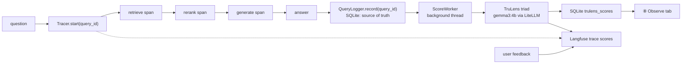

# Phase 7b — TruLens and Langfuse: design

**Status:** approved in conversation, awaiting written-spec review
**Branch:** `feat/phase-7b-trulens-langfuse`
**Follows:** Phase 7a (observability core: SQLite log, ⑧ Observe, feedback, drift). **Followed by:** Phase 8 (security and governance).

## Goal

Add the two observability tools teams use for LLM applications, each for what it does best, on top of the Phase 7a SQLite log:

- **Langfuse** for *tracing*: every question becomes a trace with live spans (retrieve, re-rank, generate), the prompt, tokens, timings and scores, viewed in Langfuse's web UI.
- **TruLens** for *feedback functions*: its RAG triad (context relevance, groundedness, answer relevance) scores every answer automatically.

The SQLite log stays the single source of truth. Both tools are add-ons that can be switched off, and a failure in either never breaks or slows an answer.

**Success looks like:** ask a question in the playground, the API or `ask.py`; open Langfuse Cloud and see the full trace with its spans and scores; see the TruLens triad scores in ⑧ Observe a minute or two later. CI stays green without either tool installed.

## Decisions already made

| Topic | Decision |
|---|---|
| Langfuse hosting | **Langfuse Cloud free tier** (keys in `.env`). Self-hosting (six containers, 4–6 GB RAM) was rejected for this machine. The host is a setting, so a self-hosted Langfuse works later with no code change. |
| What Langfuse receives | **Full text everywhere**, including the playground: question, answer, retrieved chunk text and the prompt. The privacy switch from 7a still applies: with `RAG_OBSERVE_STORE_TEXT=false`, Langfuse gets SHA-256 hashes instead of text and no prompt. The playground shows that uploads are sent to Langfuse Cloud while it is enabled. |
| When TruLens scores | **Every answer, automatically**, on a background worker after the answer is delivered, so answers keep their normal speed. |
| TruLens judge | **`gemma3:4b`** on Ollama: about 4 GB, so it stays loaded next to `qwen3:8b` (about 10.5 GB together on 18 GB) and models are not swapped. The careful Phase 4 evaluation and the CI gate keep `gemma3:12b`. Settings reject a TruLens judge equal to the generator. |
| Integration style | **Thin adapters behind interfaces** (approach 1 of 3). Native `@observe`/`TruApp` instrumentation was rejected because it couples the core to two vendors and adds a second database; a pure OpenTelemetry route was rejected as more configuration for less learning value. |
| TruLens dashboard | Still excluded (it pins `plotly<7`; the playground needs `plotly>=7.1`). Scores are shown in ⑧ Observe, as the 7a spec decided. |

## Facts that shaped the design

Checked against the real packages (Langfuse SDK 5.0.2, TruLens 2.15.0):

- Langfuse cannot back-date a span's **start**: `start_observation` has no start-time argument; only `end(end_time=...)` exists. So traces are built **live**, while each stage runs, not reconstructed afterwards.
- `Langfuse.create_trace_id(seed=...)` derives a stable trace id from any string. Seeding it with the SQLite `query_id` lets late scores (TruLens, 👍/👎) attach to the right trace with nothing extra stored.
- The packages resolve with the project: 24 new packages; existing ones change only `openai` 3.3 → 2.54 (LiteLLM caps it below 3; the 2.x chat and streaming API is what the generator already uses), `rich` 14.3 → 13.9 and `filelock` 4.0 → 3.32. Plotly 7.1, RAGAS, DeepEval and Streamlit are unchanged.

## Architecture

### New modules (`src/rag_eval_platform/observability/`)

| Module | Responsibility | Depends on |
|---|---|---|
| `tracing.py` | The vendor-neutral interface: `Tracer.start(query_id, question, metadata) -> TraceHandle`; `TraceHandle.span(name, input) -> SpanHandle`, `TraceHandle.finish(answer=..., error=...)`; `SpanHandle.end(output=..., error=..., details)`. `NoopTracer` is the default. Handles are explicit objects (not "current span" context), so they are safe across the playground's background stream thread. | Nothing |
| `langfuse_tracer.py` | `LangfuseTracer` implements `Tracer` with the Langfuse SDK; trace id = `create_trace_id(seed=query_id)`. `score(query_id, name, value, comment)` attaches a score to that trace. `trace_url(query_id)` for links. Hashes text when `RAG_OBSERVE_STORE_TEXT=false`. Every SDK call is wrapped: errors log a warning and are swallowed. `create_tracer(settings)` returns `NoopTracer` when disabled, keys are missing or the package is not installed. | `langfuse` (lazy import) |
| `trulens_scorer.py` | `TriadScorer.score(question, contexts, answer) -> TriadScores` using TruLens' LiteLLM provider against Ollama (`ollama/<judge>`, with the Ollama address derived from `RAG_OLLAMA_BASE_URL` minus its `/v1` suffix): context relevance (mean over retrieved chunks), groundedness, answer relevance, each 0–1 with the judge's reason. | `trulens-*` (lazy import) |
| `score_worker.py` | `ScoreWorker`: one background thread and a bounded queue of `query_id`s. For each: load the query from SQLite, skip refusals and errors, score, save rows to `trulens_scores`, send the three scores to Langfuse. Never raises; a full queue drops the job with a warning. `stop()` drains politely on shutdown. | Scorer, store, tracer |

### Changes to existing code

- **Query id at the start.** `RagPipeline` and the playground create the `query_id` when the question arrives and pass it to the tracer and to `QueryLogger.record(..., query_id=...)` / `record_error(..., query_id=...)` (new optional argument; the logger still creates one when it is not given). The SQLite row and the Langfuse trace share one id.
- **Spans.** `RagPipeline.ask_timed`, `ask_stream` and the playground's live run open spans around retrieval, re-ranking and generation; streaming records the time to first token and ends the generate span when the stream finishes. `Retriever` gains an optional hook so re-ranking is its own span.
- **Logger hand-off.** `QueryLogger` gets an optional `on_recorded` callback; the factories wire it to the process's `ScoreWorker`.
- **Feedback.** `record_feedback` also sends `user_feedback` (1 or 0, with the comment) to Langfuse.
- **Store schema v2 → v3.** New table `trulens_scores (query_id, metric, value, reason, judge, ts)`, primary key `(query_id, metric)`; the v2 file upgrades in place, as v1 → v2 did. `LogSet` merges it like the other tables.

## Where tracing and scoring run

| Path | Trace | TruLens |
|---|---|---|
| API (`/query`, `/query/stream`) | Live trace per request | Background worker started in the app lifespan; stopped (and Langfuse flushed) on shutdown |
| Playground chat | Live trace per question | One worker per Streamlit server (`st.cache_resource`) |
| `ask.py` | Live trace; Langfuse flushed before exit | **Not scored in the background** (the process exits at once); the catch-up command scores it |
| API in Docker | Live trace (keys passed from `.env` through compose `env_file`, optional) | Worker in the container; judge reached at `host.docker.internal`, like the generator; the image includes the `monitoring` extra |

**Catch-up command.** `scripts/run_trulens.py --pending` scores every logged answer (not a refusal or error) that has no TruLens scores yet; `--last N` limits it. It covers `ask.py`, a full queue, and anything lost when a process stopped. Exit code 0 on success, 2 when it cannot run.

## What each tool receives

**Langfuse trace** (`name="rag-query"`):
- Trace input/output: question and answer. Tags: source (`api`, `cli`, `playground`). Metadata: collection, answer style, prompt version, top-k, re-ranking on/off.
- `retrieve` span (type `retriever`): the retrieved chunks (id, document, page, score, text).
- `rerank` span (only with re-ranking): candidate order before and after.
- `generate` span (type `generation`): model, parameters (temperature, max tokens, reasoning effort), the full prompt (system and user messages), the answer, input/output tokens, completion start time (first token).
- Errors: the failing span ends with level `ERROR` and the message. This goes only to the user's own Langfuse project, never to an API caller.
- `RAG_OBSERVE_STORE_TEXT=false`: hashes instead of question, answer and chunk text; no prompt.

**Scores on the trace:** `trulens_context_relevance`, `trulens_groundedness`, `trulens_answer_relevance` (0–1, reason as comment), and `user_feedback` (1 for 👍, 0 for 👎, with the comment).

**TruLens** receives nothing remote: it runs locally against Ollama.

## Settings

All have defaults; `.env.example` documents them with empty secret values.

| Setting | Default | Notes |
|---|---|---|
| `LANGFUSE_PUBLIC_KEY` / `LANGFUSE_SECRET_KEY` | empty | Langfuse's standard names, unprefixed like the other keys; the secret is a `SecretStr`. Only in `.env`. |
| `RAG_LANGFUSE_HOST` | `https://cloud.langfuse.com` | EU region; `https://us.cloud.langfuse.com` for the US region, or a self-hosted URL |
| `RAG_LANGFUSE_ENABLED` | `true` | Does nothing until both keys are set |
| `RAG_TRULENS_ENABLED` | `true` | Background scoring on or off |
| `RAG_TRULENS_JUDGE_MODEL` | `gemma3:4b` | Rejected if equal to `RAG_LLM_MODEL` |
| `RAG_TRULENS_QUEUE_SIZE` | `100` | Jobs beyond it are dropped with a warning |

## Error handling

- Tracing: every Langfuse call is wrapped; a failure logs a warning once per kind and the answer continues. The SDK sends in the background; `flush()` runs on API shutdown, after `ask.py` answers, and at playground exit.
- Scoring: a failed score saves no row, so the catch-up command retries it later. The worker thread catches everything; it never takes the process down.
- Missing pieces degrade quietly: no keys, the extra not installed, Ollama or the judge model missing → tracing or scoring is off, and the ⑧ tab says why.
- Secrets: keys never appear in logs, traces or error messages. The pre-commit hook and gitleaks keep guarding commits; CI never needs the keys.

## ⑧ Observe tab and header

- Header status pills: Langfuse (on, off or no keys) and TruLens (on, off, judge missing).
- Recent questions table: three TruLens columns (blank while pending).
- A triad tile (averages over the selected range) and a triad trend chart.
- Answer detail: the three scores with the judge's reasons, and **Open trace in Langfuse** (`trace_url`).
- Playground chat: a one-line note under the input while Langfuse is enabled: uploads and answers are sent to Langfuse Cloud.

## Dependencies

A new optional extra, `monitoring`: `trulens-core`, `trulens-feedback`, `trulens-providers-litellm`, `langfuse`. CI does not install it. mypy skips these packages (as it does `sentence_transformers` and `openai`), and every import is lazy through `import_optional`.

## Testing

**Unit (fakes, run in CI):**
- `NoopTracer` and the tracing interface; `LangfuseTracer` against a fake client that records calls: trace id seeded from `query_id`, spans and their order, generation details, hashing with `STORE_TEXT=false`, swallowed SDK errors, `NoopTracer` when keys or package are missing.
- `TriadScorer` with a fake provider: averaging context relevance, reasons kept, values clamped to 0–1.
- `ScoreWorker`: processes queued ids, skips refusals and errors, saves rows, sends scores, drops on a full queue, survives scorer and store errors, `stop()` drains.
- Store v2 → v3 upgrade in place; `trulens_scores` round trip; `LogSet` merge.
- Settings: judge equal to the generator rejected; defaults.
- Pipeline and playground: the same `query_id` reaches the tracer and the logger; spans for each stage; stream ends the generate span; errors end spans with `ERROR`.
- Feedback sends `user_feedback`; the catch-up command picks only unscored answers.

**Integration (skip when unavailable, never in CI):**
- Real TruLens triad with `gemma3:4b` on a tiny example (skips without Ollama or the model).
- Real Langfuse Cloud round trip (skips unless both keys are set).

## Docs

`docs/learning/phase-7b.md` (simple English with analogies, the concepts and a file-by-file code walkthrough, as in earlier phases), plus the readme (Phase 7 status, commands, setup), `CLAUDE.md`, the architecture tooling table (TruLens and Langfuse → in use) and `.env.example`.

## Out of scope

Self-hosting Langfuse; Langfuse prompt management and datasets; TruLens' own database, `TruApp` instrumentation and dashboard; sampling (every answer is scored); scoring with `gemma3:12b` in the background; alerting outside the app.
